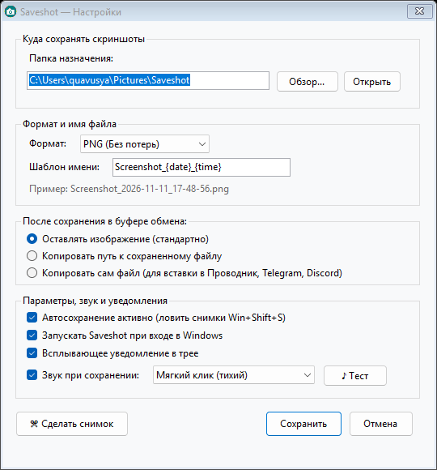

<h1 align="center">Saveshot</h1>

If you, like me, wonder why Windows 10/11 still doesn't automatically save cropped screenshots to a file, you can forget about this problem. Saveshot is a lightweight utility that automatically saves your Snipping Tool (Win + Shift + S) captures directly to any folder you choose. The application consumes less than 10 MB of RAM and includes a few essential settings.

Если у вас, как и у меня, возникает вопрос - почему в Windows 10/11 до сих пор не сделали нормальное автоматическое сохранение вырезанной области, то можете забыть про эту проблему. Saveshot это утилита, которая автоматически сохраняет ваши скриншоты из инструмента «Ножницы» (Win + Shift + S) в любую удобную вам папку. Приложение потребляет менее 10 МБ оперативной памяти и содержит необходимые настройки.

  

